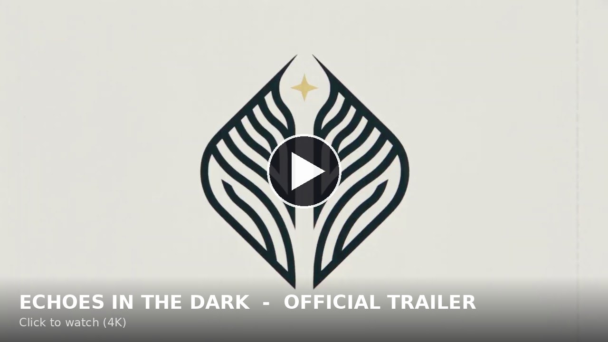

# Brandy — Echoes in the Dark game projects

## Trailer

**[▶ Watch the Echoes in the Dark trailer](https://drive.google.com/file/d/10rJlKpkIJEyC_wISI6FlmzRn6npThSgE/view?usp=drive_link)** · 4K, hosted on Google Drive (5.3 GB) · [direct download](https://drive.google.com/uc?export=download&id=10rJlKpkIJEyC_wISI6FlmzRn6npThSgE)

| Project | What it is | Play it |
|---|---|---|
| [`echo-strike/`](echo-strike/) | **Echo Strike** — BloodStrike-style shooter inside Minecraft 1.20.1 (Forge). 10 guns rebuilt from the BloodStrike roster, slide / vault / tac-sprint movement, enemy operatives, Wave Survival and Battle Royale. | `download/Play-Echo-Strike.bat` (Windows one-click) or drop `download/echostrike-1.0.0.jar` into `mods/` |
| `tmnt-story-mode/` | TMNT Turtle Power: Story Mode — fan-made story mod with a pre-built New York. | `download/Play-TMNT-Story-Mode.bat` |

Both are Forge 1.20.1 mods; NeoForge 1.20.1 runs them too.

## Echo Strike quick start

1. Double-click `download/Play-Echo-Strike.bat` (installs the mod loader, the mod and the arena world, adds an "Echo Strike" launcher profile).
2. Press PLAY. You spawn in the arena with a G18.
3. `/strike kit` for a full loadout, `/strike waves start` to fight waves, `/strike br start` for Battle Royale with bots.

Left click shoots, right click aims, `R` reloads, sprint + crouch slides, run at a block to vault.
Full docs in [`echo-strike/README.md`](echo-strike/README.md).
