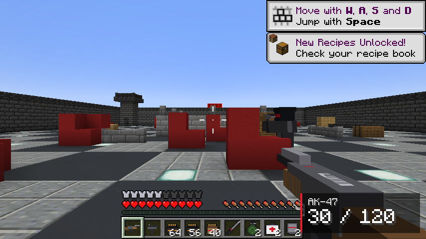
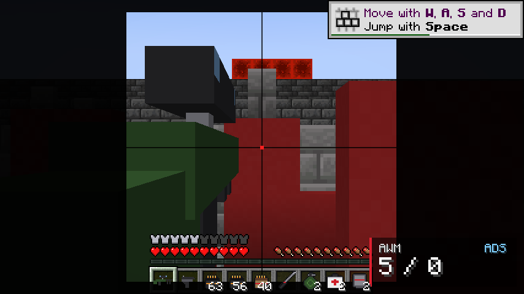
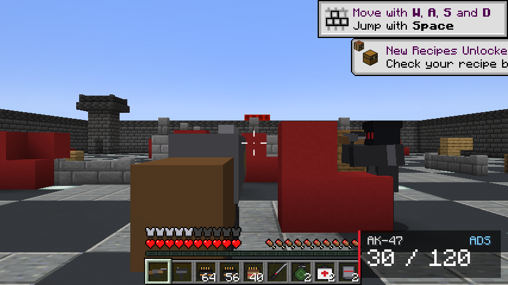
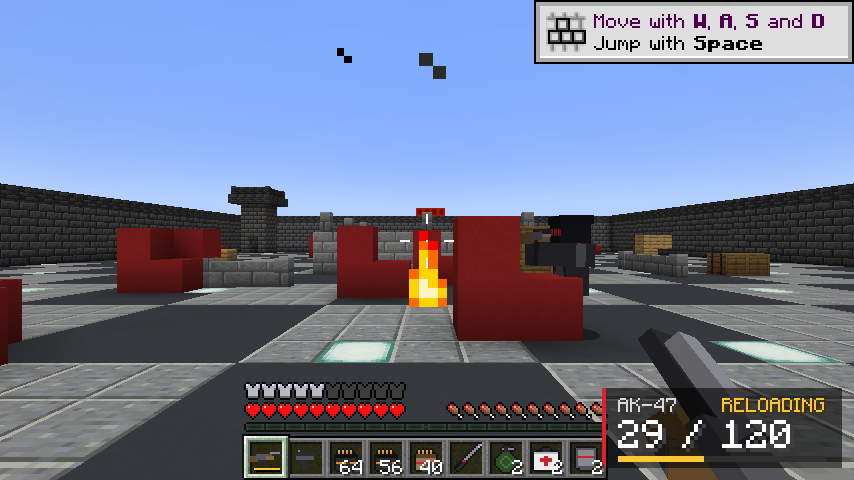
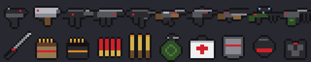
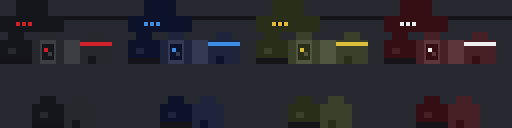
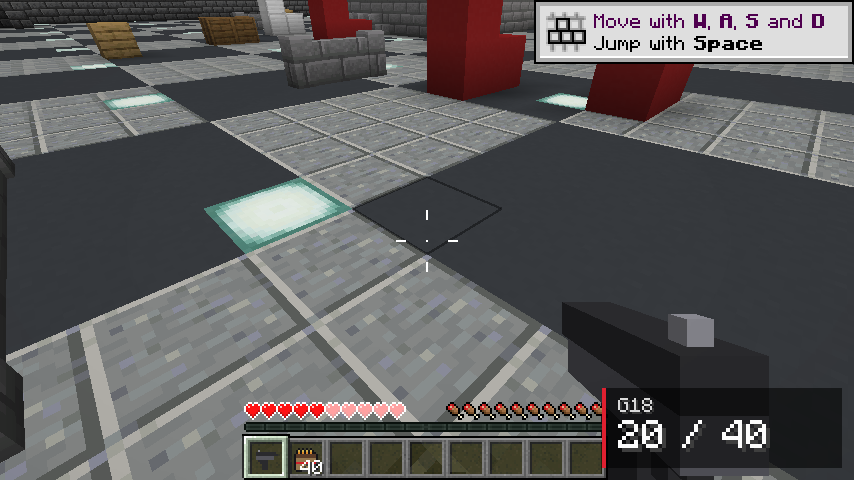

# Echo Strike — BloodStrike-style shooter inside Minecraft

An Echoes in the Dark original. A Forge mod for **Minecraft Java 1.20.1** that turns the game
into a fast shooter: the BloodStrike weapon lineup rebuilt as hitscan guns with magazines,
reloads, recoil and headshots; slide / vault / tactical-sprint movement; grenades, medkits and
armor plates; enemy operatives with gun AI; and two game modes with a shrinking zone.

Everything in here (code, pixel art, numbers) is ours. Nothing is copied from BloodStrike —
that game is NetEase's closed-source property and copying its files would get the mod taken
down. The guns and the movement are **rebuilt from how they feel**, not ripped.




Every gun is a real 3D model (built from cubes, like the big gun mods) with procedural
first-person animation: recoil kick, aim-down-sights, reload tilt and a sprint carry. The AWM gets a
4x scope overlay.

| | |
|---|---|
|  |  |
|  |  |

## Controls

| Action | Key |
|---|---|
| Shoot (hold for full auto) | Left click |
| Aim down sights (zoom, tighter spread) | Hold right click |
| Reload | `R` |
| Slide | Sprint, then tap crouch |
| Vault / mantle | Run into a 1-block obstacle, or jump at a 2-block wall |
| Tactical sprint | Just sprint while holding a gun (you're faster) |
| Throw grenade / use medkit / slap in a plate | Right click with the item |

## The guns

| Gun | Class | Fire | Damage (half-hearts) | Mag | Ammo |
|---|---|---|---|---|---|
| G18 | Pistol | Auto | 3.2 | 20 | Light |
| Desert Eagle | Pistol | Semi | 9 | 7 | Heavy |
| MP5 | SMG | Auto | 3.5 | 30 | Light |
| UMP45 | SMG | Auto | 4.4 | 25 | Light |
| Vector | SMG | Auto (20 rounds/s) | 2.8 | 33 | Light |
| AK-47 | Rifle | Auto | 6.2 | 30 | Heavy |
| M4A1 | Rifle | Auto | 5.0 | 30 | Heavy |
| M870 | Shotgun | Pump | 2.6 × 8 pellets | 6 | Shells |
| AWM | Sniper | Bolt, 4x scope | 22 | 5 | Sniper rounds |
| M249 | LMG | Auto | 4.5 | 100 | Heavy |

Headshots do 1.5x–2.5x. Shotgun and SMG damage falls off with range. Sprinting or jumping
widens your spread, crouching and aiming tighten it. The crosshair shows the real cone of fire.

Plus: Combat Knife, Frag Grenade (bounces, 2s fuse, no block damage), Medkit (hold 2s: +5 hearts
and regen), Armor Plate (+4 shield hearts, stacks to 8), Strike Vest and Strike Helmet.
Everything is craftable (iron, redstone, gunpowder, planks) and sits in the **Echo Strike**
creative tab.

## Game modes — `/strike`

| Command | What it does |
|---|---|
| `/strike arena` | Builds a 53×53 arena around you: walls, cover, two sniper towers, lit floor |
| `/strike kit [assault\|m4\|smg\|sniper\|shotgun\|heavy\|pistol]` | Full loadout with armor, nades, medkits, plates |
| `/strike waves start` | **Wave Survival.** Operatives spawn around you in growing waves. Clear a wave, get supplies, every 3rd wave a new gun. |
| `/strike br start [minutes] [bots]` | **Battle Royale.** Everyone is scattered with a pistol, loot crates drop around the map, the zone shrinks to a point, last one standing wins. Bots fill the lobby (default 12). |
| `/strike crate` | Drops a loot crate in front of you |
| `/strike stop` | Ends the game, restores the world border |
| `/strike status` | What's running |

Operatives come in 5 tiers (better guns, armor, aim). They strafe, close in, back off, fire in
bursts and fight each other if they're on different squads. Kill them for ammo, medkits, plates
and sometimes their gun.

## Installing

1. Install Forge or NeoForge for Minecraft 1.20.1.
2. Drop `echostrike-1.0.0.jar` (from `../download/`) into your `.minecraft/mods` folder.
3. Start a world. You spawn with a G18 and a welcome message. Type `/strike` for help.

Windows one-click: double-click `download/Play-Echo-Strike.bat`. It installs the mod loader, the
mod, and adds an "Echo Strike" profile to the Minecraft Launcher.

## The shipped world

`download/Echo-Strike-World.zip` (and the one-click installer) carry a normal-terrain world with
the arena built at spawn, so the first thing you see is the arena. Battle Royale spreads out over
the real terrain around it.



## Building

```
cd echo-strike
./gradlew build            # jar lands in build/libs/
python3 tools/gen_assets.py   # regenerates the pixel art and item models
./gradlew runClient -Pdevtest="World Name"                   # scripted play test with screenshots
./gradlew runClient -Pdevtest="World Name" -PdevtestMode=guns  # screenshots of every gun's model and animations
./gradlew runClient -Pdevtest="World Name" -PdevtestMode=world # build the arena at spawn and save (shipped world)
python3 ../installer/build_echostrike_installer.py             # rebuild download/Play-Echo-Strike.bat
```

Project layout:

```
src/main/java/com/echoesinthedark/echostrike/
  item/        GunType (the roster and numbers), GunItem, grenade, medkit, plate, knife, armor
  combat/      Gunplay (hitscan, spread, headshots, tracers), damage types
  entity/      OperativeEntity + GunAttackGoal (enemy AI), GrenadeEntity
  client/      GunController (trigger, aim, recoil), MovementController (slide, vault), StrikeHud
  game/        StrikeGame (Waves + Battle Royale), ArenaBuilder, LootCrates
  command/     /strike
  network/     shoot / reload / hitmarker packets
```
