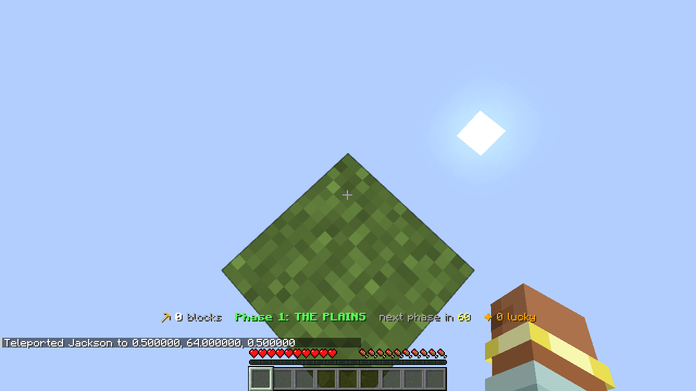
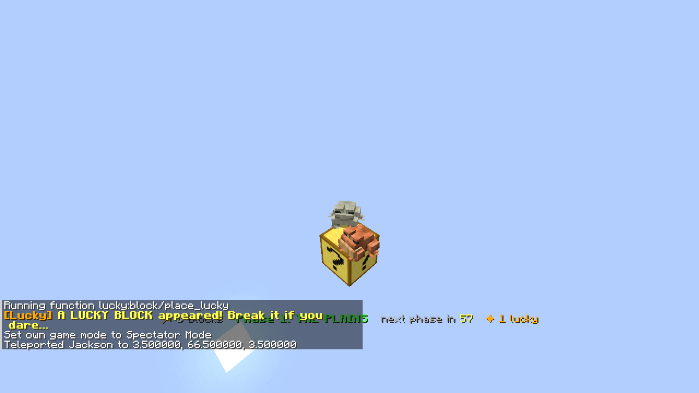
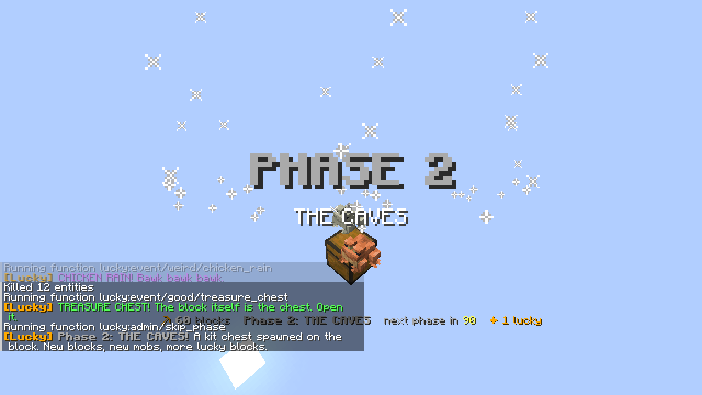
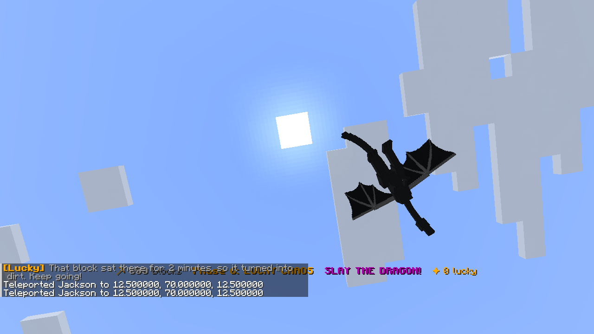

# One Block: Lucky Block Edition

A Minecraft: Java Edition world by **Echoes in the Dark**. You spawn in the void on a single
block. Break it and it comes back as something new: a random block, a loot chest, a mob, or a
**Lucky Block** that can make your day or wreck it. Survive six phases, build a sky island out of
whatever you pull, and at 800 blocks the **Ender Dragon** shows up for the final boss fight.

No mods. Everything runs on a vanilla datapack packed inside the world, plus a tiny built-in
resource pack that makes the Lucky Block look like a Lucky Block.

## Install the easy way (double-click)

- **Windows:** download `Install OneBlock Lucky Block - Windows.bat` and double-click it. If
  Windows shows "protected your PC", click **More info** then **Run anyway** (it is a plain
  script; you can open it in Notepad). It copies the world into your saves folder and opens the
  Minecraft Launcher. Click Play, then Singleplayer, and the world is at the top.
- **Mac:** download `Install OneBlock Lucky Block - Mac.zip`, unzip it, double-click the
  `.command` file (right-click, Open the first time). Same thing: installs, then opens Minecraft.

Both installers carry the whole world inside them, so they work offline.

## Install by hand (2 minutes)

1. Download `OneBlock_Lucky_Block.zip` from this folder and unzip it. You get a folder called
   `OneBlock Lucky Block`.
2. Put that folder inside your Minecraft `saves` folder:
   - **Windows:** press `Win + R`, type `%appdata%\.minecraft\saves`, Enter.
   - **Mac:** in Finder press `Cmd + Shift + G`, paste `~/Library/Application Support/minecraft/saves`.
   - **Linux:** `~/.minecraft/saves`
3. Start **Minecraft: Java Edition** (the current release, 26.x) and open the world from
   Singleplayer. It opens straight in, no upgrade screen.
4. You are standing on the block. Punch it.

Still on **1.21.x**? Use `legacy-1.21/OneBlock_Lucky_Block_1.21.zip` instead. Same game, saved in
the older world format (that one shows a "create a backup?" screen on newer versions; just say yes).

Works in LAN multiplayer too: Open to LAN, friends join, everyone shares the one block.

## How it plays

| Phase | Starts at | Theme | What shows up |
| --- | --- | --- | --- |
| 1 | block 0 | The Plains | grass, logs, leaves, stone, coal, animals |
| 2 | block 60 | The Caves | ores, deepslate, amethyst, zombies, skeletons, a rare spawner |
| 3 | block 150 | The Wild | jungle, cherry, ice, mud, prismarine, pandas, drowned, witches |
| 4 | block 260 | The Nether | netherrack, quartz, ancient debris, piglins, blazes, ghasts |
| 5 | block 400 | The End & Deep Dark | end stone, purpur, sculk, endermen, shulkers, breezes, a rare warden |
| 6 | block 560 | Lucky Chaos | everything, diamond ore, netherite, beacons, every mob |
| Boss | block 800 | THE DRAGON | a 13x13 arena rises from the void, a boss kit chest spawns, the dragon lands |

Every time you enter a new phase you get a **kit chest** on the block with the stuff you need
next (pickaxe, buckets, saplings, potions, gear).

Each block you break rolls:

- **Plain block** from the phase table (most of the time).
- **Loot chest or barrel** (10%) filled from a phase-specific loot table.
- **Mob** (10 to 14%) spawned right on top of you. Hold on.
- **Lucky Block** (6% in Phase 1, rising to 13% in Phase 6). Break it to roll an event:
  - **50% good:** diamonds, enchanted gear, enchanted books, golden apples, XP, a totem, a
    starter farm pack, water + lava buckets, a 3x3 land platform, an ore pillar, traders,
    pets, a treasure chest, a Lucky Box, a beacon kit, an iron golem, and a very rare elytra.
  - **30% bad:** TNT, creepers, anvils from the sky, lightning, hordes that scale with your
    phase, witches, skeleton squads, cobweb traps, levitation, poison clouds, silverfish, a fake
    diamond, a lava trap that clears after 5 seconds, midnight with phantoms, blazes, illagers,
    and two ultra-rare nightmares: the Warden (phase 5+) and the Wither (phase 6).
  - **20% weird:** chicken rain, rainbow sheep, a fireworks show, a pumpkin on your head,
    blindness, zoomies, tiny slimes, a jukebox and disc, bats, a Giant, a villager rave, frogs,
    snow golems, a pig parade, bees.

Drops pop **up** onto the block instead of falling into the void. If you fall, **void rescue**
teleports you back (you can turn it off). Inventory is kept on death. If the block turns into
something you can't mine yet, wait 2 minutes and it becomes dirt, or use the reroll command.

Beat the dragon and everyone gets a dragon egg, a dragon head, an elytra and 64 rockets. The
block keeps going forever after that in Lucky Chaos.

## Commands (type in chat)

| Command | Needs cheats? | What it does |
| --- | --- | --- |
| `/trigger ob.help` | no | shows the rules |
| `/trigger ob.rescue` | no | toggles void rescue on/off |
| `/trigger ob.reroll` | no | replaces a stuck block with dirt |
| `/function lucky:admin/stats` | yes | blocks, phase, lucky blocks, chests, mobs so far |
| `/function lucky:admin/skip_phase` | yes | jump to the next phase |
| `/function lucky:admin/reset` | yes | start over at block 0 |

Cheats are already enabled in the world for the admin commands.

## What's in this folder

```
oneblock-lucky-block/
  Install OneBlock Lucky Block - Windows.bat   <- double-click installer (world inside)
  Install OneBlock Lucky Block - Mac.zip       <- double-click installer for Mac
  OneBlock_Lucky_Block.zip        <- the world (newest save format), ready to share or sell
  world/OneBlock Lucky Block/     <- the same world, unzipped
    level.dat, data/, dimensions/ <- void superflat world, spawn on the block, gamerules
    icon.png                      <- lucky block icon in the world list
    resourcepacks/resources.zip   <- built-in texture pack (lucky block texture + names)
    datapacks/lucky_oneblock/     <- the whole game: 113 functions, 16 loot tables
  legacy-1.21/                    <- the same world in 1.21.x format + its zip
  screenshots/                    <- real in-game screenshots (26.3 client)
  tools/build_oneblock_world.py   <- generates the world and the datapack
  tools/upgrade_world.sh          <- re-saves it in the newest format with a vanilla server
  tools/build_installers.py       <- bakes the zip into the double-click installers
```

## Screenshots

Taken in a real Minecraft 26.3 client with the world installed.






## Changing the game

Everything is generated from `tools/build_oneblock_world.py`. Edit the block tables, mob lists,
phase thresholds, lucky odds or events there, then run:

```
pip install nbtlib pillow
python3 tools/build_oneblock_world.py
```

That rewrites `legacy-1.21/`. Then `tools/upgrade_world.sh <java 25> <26.x server.jar>` re-saves it
into `world/` and `OneBlock_Lucky_Block.zip`, and `python3 tools/build_installers.py` rebuilds the
installers. The datapack uses only vanilla commands, so it keeps working across game updates: the
world was booted on both 1.21.1 and 26.3 vanilla servers with every event, loot table and the boss
fight exercised from the console, and then played in a real 26.3 client (see screenshots).

## Credits

Made by Echoes in the Dark. Minecraft is a trademark of Mojang/Microsoft. This is a fan-made
world; it does not include any Mojang assets.
